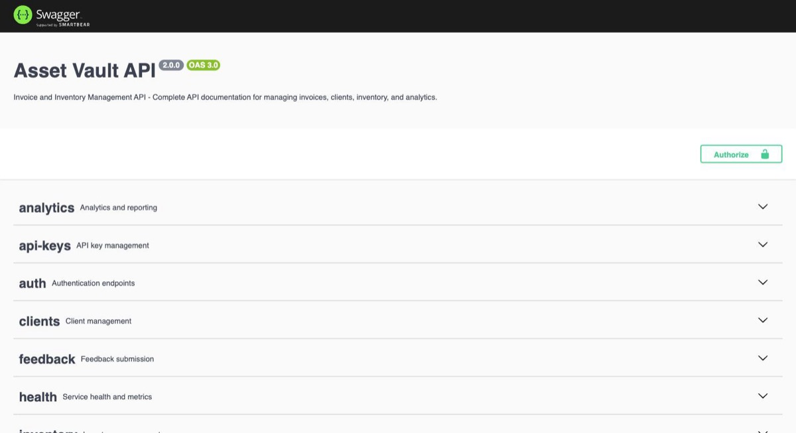
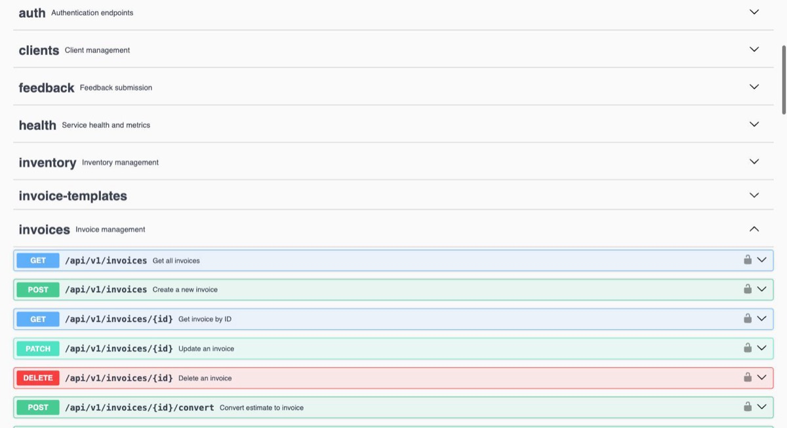

# Asset Vault

<!--portfolio-note-->
> **Portfolio note —** one of three invoicing builds exploring the same problem across stacks: this one (React 19 + NestJS 11 + PostgreSQL, with Clerk and Stripe), [pizza-box-system](https://github.com/seifosmaan53/pizza-box-system) (React + Express + Prisma) and [invoiceme](https://github.com/seifosmaan53/invoiceme) (Flutter client + NestJS API).

> Invoice, inventory, and multi-store management for small businesses, built to be self-hosted.
>
> **Status: tested portfolio build, not a deployed service.** It builds and passes CI, but it has no hosted instance and no production users. Treat it as reference code, not a hosted product. See [Security model and known limitations](#security-model-and-known-limitations) before running it anywhere public.

[](https://react.dev)
[](https://nestjs.com)
[](https://typescriptlang.org)
[](https://postgresql.org)
[](https://docker.com)

---

## A look at it

The API serves OpenAPI (Swagger) docs at `/api/docs`, organised into 21 tagged areas and
generated from the controllers themselves rather than maintained by hand.



Every route carries its auth requirement, parameters and response schema:



---

## Why this exists

I work in retail/pharmacy operations supporting a network of 890 stores, and the recurring pain there is the same one small multi-location businesses hit everywhere: invoicing, stock levels, and per-store reporting live in separate spreadsheets or disconnected tools. Asset Vault is my take on collapsing that into one self-hosted app: invoices, inventory (with reorder alerts and inter-store transfers), clients, and Stripe-metered subscription plans. Every record belongs to the user who created it (see [Security model](#security-model-and-known-limitations)).

It's also one of a set of three invoicing rebuilds I made to compare approaches: this one uses NestJS + TypeORM + Clerk with a React web client; [pizza-box-system](https://github.com/seifosmaan53/pizza-box-system) does the same domain with Express + Prisma; [invoiceme](https://github.com/seifosmaan53/invoiceme) pairs a Flutter client with a NestJS API. See [Key engineering decisions](#key-engineering-decisions) below for why this one is built the way it is.

---

## Features

Each item below maps to code in `backend/src/` and `frontend/src/` — no unverified claims.

- **Invoices** — CRUD, status transitions, PDF export (`invoices/invoice-pdf.service.ts`, Puppeteer-rendered), email delivery (`POST /:id/send` via `MailService`, SendGrid/SMTP)
- **Inventory** — SKU/barcode items, stock movements, reorder-level alerts (`inventory/store-alerts.service.ts`), bulk CSV import with per-row error reporting
- **Multi-store** — stores owned per user, store-to-store stock transfers (`inventory/store-transfer.service.ts`), per-store item settings and alert thresholds
- **Organizations and memberships** — an `organizations/` API for creating an organization and managing its members (owner/admin/manager/staff). Membership changes are authorised on the server from the caller's own membership rows. **Business data (invoices, clients, inventory, stores) is not partitioned by organization: it is owned per user.**
- **Clients** — contact database tied to invoice history
- **Analytics & reports** — revenue/payment-method breakdowns and PDF store reports (`analytics/store-report-pdf.service.ts`)
- **Subscription billing** — Stripe customer/subscription sync, webhook-driven plan updates, per-plan usage quotas enforced by a `QuotaGuard`
- **API keys** — keys can be created, rotated and revoked, but nothing authenticates requests with them yet
- **Invoice templates** — saved, reusable invoice layouts
- **Read cache** — a small IndexedDB layer in the frontend (`frontend/src/utils/indexedDB.ts`) caches reads. The app does not work offline: writes always need the API.
- **Dark/light mode, keyboard shortcuts, draggable sidebar** — frontend UX conveniences in `frontend/src/components`
- **One invoice-money implementation** — validation and totals are a single module, `backend/src/common/money/invoice-money.ts`, used by both the API and the invoice form.
  - Exact integer-cent arithmetic, rounding half away from zero.
  - Rates up to four decimals, stored as `numeric(7,4)`.
  - Every input and computed amount is limited to what the `numeric(12,4)` columns store (99,999,999.99).
  - Two decimals for every currency, an existing limitation.

  See [docs/INVOICE-MONEY.md](docs/INVOICE-MONEY.md).

---

## Architecture

```
┌──────────────────────────────┐
│            Browser            │
│  React 19 + Vite + MUI        │
│  TanStack Query + axios       │
│  IndexedDB read cache         │
└──────────────┬───────────────┘
               │ REST (JSON), Authorization: Bearer <Clerk session token>
               ▼
┌───────────────────────────────────────┐
│              NestJS 11 API             │
│  /api/v1/*   per-module controllers    │
│  /api/docs   Swagger                   │
│                                         │
│  Global guards, in order:               │
│  Throttler → ClerkAuthGuard             │
│  → RolesGuard → SubscriptionGuard       │
│  (QuotaGuard on invoice creation)       │
└───────┬─────────────────┬──────────────┘
        │                 │
        ▼                 ▼
┌───────────────┐  ┌──────────────────────┐
│ PostgreSQL 15  │  │  External services    │
│ via TypeORM    │  │  Clerk (auth, webhook) │
│ (40 migrations)│  │  Stripe (billing)      │
└───────────────┘  │  SendGrid/SMTP (mail)  │
                    │  S3/R2 (file storage)  │
                    └──────────────────────┘
```

A tRPC layer (four routers, `backend/src/trpc/`) exists on the server but the web client does not call it; **all application traffic is REST.**

**Auth flow (Clerk):** the frontend uses `@clerk/clerk-react` to obtain a session token and sends it as a bearer token. `ClerkAuthGuard` (`backend/src/auth/clerk-auth.guard.ts`) **verifies the token's signature and expiry** with `verifyToken` from `@clerk/backend` (networkless if `CLERK_JWT_KEY` is set, otherwise against the instance's cached JWKS), and only then trusts its `sub` claim. It then re-checks the user against Clerk's API on every request, with no caching, so a deleted or banned account is rejected immediately. User lifecycle events arrive at `POST /api/v1/auth/webhooks/clerk`, verified with `svix` signature headers.

**Billing flow (Stripe):** `subscriptions/stripe.service.ts` drives customer/subscription creation; `stripe-webhook.controller.ts` consumes Stripe webhook events to keep the local `Subscription`/`Plan`/`Usage` entities in sync; `QuotaGuard` and `SubscriptionGuard` enforce plan limits on protected routes; `usage-reset.scheduler.ts` resets usage counters on a cron schedule.

**About the tRPC code:** four routers (`invoices`, `clients`, `inventory`, `analytics`) are mounted at `/api/v1/trpc`, but the web client's data layer is axios + TanStack Query over REST, and `frontend/src/utils/trpc.ts` is not yet typed against the real `AppRouter`. Treat the tRPC routers as unused scaffolding. Webhooks and file uploads are plain REST by necessity (raw-body signature verification, multipart).

---

## Key engineering decisions

**REST with Swagger vs. tRPC.** I added tRPC routers hoping to get end-to-end types, then kept the REST API as the real interface because the client was already built on it and webhooks and uploads need plain HTTP anyway. Wiring the client to the router's types is unfinished, which is why this README no longer describes the project as tRPC-based.

**Clerk vs. hand-rolled JWT.** This isn't a hypothetical comparison — the codebase used to *be* the hand-rolled version. The `CHANGELOG.md` describes a JWT + bcrypt + password-reset-token + account-lockout auth system with rate-limited login/reset endpoints, and migration `1755000000000-MigrateToClerkAuth.ts` shows the actual cutover: it adds a `clerkUserId` column and drops `password`, `passwordResetToken`, `failedLoginAttempts`, `lockedUntil`, etc. from the `users` table. The `AUTH_SECURITY_IMPROVEMENTS.md` notes in `backend/` are essentially a checklist from that older system. Moving to Clerk traded self-hosted control over the auth flow for not having to maintain password hashing, reset-token expiry, and lockout logic by hand. `JwtAuthGuard` and the `passport-jwt` dependency are leftovers from the old system: no module registers them, and they are scheduled for removal.

**TypeORM vs. Prisma.** The pizza-box-system sibling uses Prisma; this one uses TypeORM with hand-written, `QueryRunner`-based migrations (40 of them in `backend/src/migrations/`, including the Clerk cutover above, plus the organization tables). That gives direct control over migration SQL for schema changes that also need to reshape existing data, which is easier to hand-write against TypeORM's `QueryRunner` than to express as a declarative schema diff.

---

## Tech stack

### Frontend
| Technology | Version | Purpose |
|---|---|---|
| React | 19 | UI framework |
| Vite | 7 | Build tool + dev server |
| Material UI | 7 | Component library |
| TypeScript | 5.9 | Type safety |
| TanStack Query | 5 | Server state + caching |
| axios | latest | REST client (`frontend/src/api/`) |
| Zustand | 5 | Global state |
| React Hook Form + Zod | latest | Forms + validation |
| Recharts | 3 | Data visualization |
| dnd-kit | 6 | Drag & drop |
| Clerk (`@clerk/clerk-react`) | 5 | Authentication |
| IndexedDB (hand-rolled) | n/a | Read caching |

### Backend
| Technology | Version | Purpose |
|---|---|---|
| NestJS | 11 | Server framework (REST + Swagger) |
| Node.js | 18+ | Runtime |
| PostgreSQL | 15 | Database |
| TypeORM | 0.3 | ORM + hand-written migrations |
| Stripe | 17 | Subscription billing |
| Puppeteer | 24 | PDF generation |
| SendGrid / Nodemailer | latest | Email delivery |
| AWS S3 / Cloudflare R2 | latest | File storage |
| Helmet + Throttler | latest | Security headers + rate limiting |
| Clerk (`@clerk/backend`) + svix | latest | Auth + webhook signature verification |
| Joi | latest | Environment variable validation |

### Infrastructure
- Docker Compose: Caddy TLS reverse proxy in front of the API and the nginx-served web app, plus Postgres (and a `frontend-dev` hot-reload profile)
- Nginx for production frontend serving
- 40 TypeORM migrations applied via a custom migration-runner script

---

## Testing

Tests come in three kinds, and the difference matters:

| Kind | Command (from `backend/`) | Database | What it covers |
|---|---|---|---|
| Unit tests | `npm test` | **Mocked** repositories (no PostgreSQL) | Service and utility logic |
| Access-control tests | `npm run test:integration` | **Real PostgreSQL**, schema built from the repo's own migrations | Authentication, per-user ownership, users, storage keys, organization membership. The real application is booted. **Clerk token verification is mocked here**: `verifyToken` is replaced by an HMAC check and the Clerk user lookup by an in-memory directory, so this suite proves the application's authorization rules, not Clerk's cryptography. The ESM-only tRPC module and the headless-Chrome PDF service are also stubbed (`backend/test/support/access-control-harness.ts`) |
| Clerk SDK configuration test | `npm test` (`src/auth/clerk-auth.guard.spec.ts`) | none | The guard against the **real** `@clerk/backend` `verifyToken`, using an RSA key pair generated in the test (offline via `CLERK_JWT_KEY`) and an intercepted JWKS request. Checks that valid tokens are accepted and that wrong-key, algorithm-confusion, `alg: none`, expired, not-yet-valid, tampered and subject-less tokens are rejected before any Clerk user lookup. No Clerk account, network or paid call is involved |
| Invoice-money tests | `npm run test:integration` (`test/invoice-money.db.spec.ts`) | **Real PostgreSQL** | Invoices created and edited through the API: stored totals and rates, limits rejected with nothing written, migration `1761000000000` down and up |
| Frontend tests | `npm test` (from `frontend/`) | n/a | Component and utility tests (Vitest), including the invoice form's totals, validation and submitted payload |

```bash
# Backend unit tests (mocked database)
cd backend && npm test

# Access-control tests: need a PostgreSQL database that is NOT a real one. They create and delete
# synthetic users (*@access-test.invalid).
createdb asset_vault_test
export NODE_ENV=test DB_HOST=localhost DB_PORT=5432 DB_USERNAME=postgres DB_PASSWORD=postgres \
       DB_DATABASE=asset_vault_test CLERK_SECRET_KEY=sk_test_local_not_real
npm run migration:run
npm run test:integration

# Frontend
cd frontend && npm test
```

`backend/test/invoices-store.integration.spec.ts` and `store-stock-validation.integration.spec.ts` are **mock-based despite their names** and are not run by `test:integration`; `npm run test:e2e` runs only `app.e2e-spec.ts`.

**CI** (`.github/workflows/ci.yml`, GitHub Actions) runs on every push and pull request to `main`: backend build, backend unit tests, migrations against a PostgreSQL 16 service, the access-control tests against that service, frontend build, frontend type-check and tests, and a dependency audit (reported, not gating). Lint runs but is not gating. See the latest run on the [Actions tab](https://github.com/seifosmaan53/asset-vault/actions) for current results rather than counts quoted here.

---

## Security model and known limitations

**Model.** Asset Vault is a per-user application. Every business record (client, store, inventory item, invoice, template, API key, settings) carries the id of the user who created it, and every query filters on the authenticated user's id taken from the verified session, never from the request. A request that references another user's record gets the same 404 as one that does not exist.

- **Authentication:** Clerk. The bearer token's signature and expiry are verified on every request (`verifyToken`), then the account is re-checked against Clerk's API. Set `CLERK_JWT_KEY` (the instance's PEM public key) to verify tokens without a JWKS network call; otherwise the SDK fetches and caches the instance's keys using `CLERK_SECRET_KEY`. Verification fails closed: any error, missing subject or unreachable key set is a 401.
- **Roles:** every account is created as `OWNER` of its own data. There is no invitation or staff-management flow, so `@Roles(...)` guards on routes distinguish nothing in practice. Role is not user-editable.
- **Subscriptions:** `SubscriptionGuard` denies business routes unless the account has an active or trialing subscription; `QuotaGuard` enforces plan limits on invoice creation.
- **Accounts (`/users`):** these routes only ever act on the caller's own account, and identity or privilege fields (email, role, password) cannot be changed through them.
- **File storage:** every object key is `{folder}/{userId}/{uuid}.{ext}` and a key is only usable by the user whose id is in it. The upload folder name is reduced to one safe segment.
- **Organizations:** the `/organizations` API manages organizations and their members. It is authorised on the server from the caller's own membership; it does **not** partition business data, so being in an organization does not share anyone's invoices or inventory.

**Verified by tests, not just by reading.** `backend/test/access-control.db.spec.ts` boots the real application against real PostgreSQL with synthetic users and checks the rules above, including forged tokens, cross-user reads and writes by id, forged owner ids, privilege escalation, storage keys, organization membership, data export, and the matching positive controls (the owner can still do each thing).

**Known limitations and open items**
- Not deployed anywhere, and not hardened for the public internet: no WAF, no audit of the Stripe and Clerk webhook handlers beyond signature checks, and `npm audit` findings remain (CI reports them without gating).
- Multipart file upload is currently rejected by the global content-negotiation interceptor ("Content-Type must be application/json"), so uploads do not work through the API as shipped.
- The API-key feature creates keys but nothing authenticates requests with them.
- The IP allow/deny middleware (`ip-filter.middleware.ts`) is never registered, so the IP-filtering environment variables have no effect.
- Adding a member to an organization by user id does not ask that user for consent. The caller must already be an owner or admin of the organization, and members are shown to each other only as id, name and email, but there is no invitation or acceptance step.
- Token verification is covered by tests against the real Clerk SDK with locally generated keys; it has not been exercised against a live Clerk instance in this review.
- `JwtAuthGuard` and `passport-jwt` are unused leftovers from the pre-Clerk auth system.
- The organization-context decorators (`@OrganizationId()`) are deprecated and always return `null`; call sites remain in two controllers.
- The `users` page and API client in `frontend/src` are not routed or linked from the UI.
- The unit suite uses mocked repositories. Against a real database, the integration tests cover access control and invoice totals, rates and limits (`test/invoice-money.db.spec.ts`), but not stock arithmetic.
- Every currency is handled with two decimal places (JPY and KWD included). This is an existing limitation, not a deliberate currency policy; see [docs/INVOICE-MONEY.md](docs/INVOICE-MONEY.md).
- CI runs the Compose stack behind its TLS proxy with dummy Clerk keys (HTTPS, redirects, CORS, migrations, graceful stop), but signing in through a real Clerk instance is not tested.

**Deployment and recovery.** These fixes are merged into the repository; the application was not deployed as part of this work and no deployment of it is known. If you deploy it and a release fails, do **not** treat redeploying the code from before this change as a rollback: that code accepted unsigned tokens and exposed other accounts' data, so it restores the vulnerabilities. Keep access restricted instead:
1. Keep the failed release out of service (stop it, or leave the load balancer or DNS pointing away from it) rather than serving it half-configured.
2. Fix forward. The usual causes are configuration: `CLERK_SECRET_KEY` unset (the API refuses to start, which is the intended fail-closed behavior), a wrong key, or a Clerk outage. Set `CLERK_JWT_KEY` to verify tokens without reaching Clerk's key endpoint.
3. If service must be restored before a fix is ready, restore a build that contains the token-verification fix, or serve a maintenance response. Never serve a build older than this change.
4. After any incident, rotate `CLERK_SECRET_KEY` if it may have been exposed, and review access logs for the exposure window.
5. **Migrations.** Release in this order: back up the database, apply migrations with the production image (`docker run --rm --env-file api.env <backend image> node dist/database/migration-runner.js`), start the API, verify `/api/v1/health`. The API never migrates by itself: it refuses to start (exit 1, naming the pending migrations and that command) while any are pending, and when the database is unreachable. Recovery is restoring the pre-migration backup or fixing forward, **not** reverting: the `down` of `1761000000000` (invoice line rates to `numeric(7,4)`) rounds rates back to two decimals and loses any precision stored since. Exact commands: [docs/operations/MIGRATIONS.md](docs/operations/MIGRATIONS.md); scripted sequence: [docs/operations/release.sh](docs/operations/release.sh).
6. **Proxy, shutdown, CORS.** Serve the API only behind a TLS proxy that overwrites `X-Forwarded-*`, and name it in `TRUST_PROXY` (default: trust nothing; a hop count or the proxy's addresses; `true` is refused). In production plain HTTP is redirected to `API_PUBLIC_URL` / `FRONTEND_URL`, never to the request's `Host`. CORS allows exactly `FRONTEND_URL`; any other `Origin` gets a 403 JSON. On SIGTERM the API finishes in-flight requests and exits 0 within `SHUTDOWN_TIMEOUT_MS` (default 8000 ms, else exit 1), so give your orchestrator a longer stop grace period. Details: [docs/setup/DOCKER_README.md](docs/setup/DOCKER_README.md#server-settings).

---

## Quick Start

### Option 1 — Docker (recommended)
```bash
git clone https://github.com/seifosmaan53/asset-vault.git
cd asset-vault
# Compose reads a ROOT .env (not backend/.env or frontend/.env). The publishable key is
# compiled into the web bundle at build time; the frontend build fails without it.
printf 'CLERK_SECRET_KEY=sk_test_...\nVITE_CLERK_PUBLISHABLE_KEY=pk_test_...\n' > .env
docker compose up -d --build
```
The API container exits until the schema is migrated (it logs the pending migrations). Apply them with the image's own runner, then start it again:
```bash
docker compose run --rm backend node dist/database/migration-runner.js
docker compose up -d --wait
```
Open **[https://localhost](https://localhost)**: that is the only browser-usable entry point. A Caddy reverse proxy terminates TLS (with a certificate from its own local CA by default; trust it or accept the warning, see [DOCKER_README](docs/setup/DOCKER_README.md#tls)) and routes `/api/*` to the API and everything else to the web app; `http://localhost` redirects to HTTPS. The API and nginx publish no ports: the API runs in production mode, enforces HTTPS and trusts forwarded headers only from the proxy, so it is not usable directly over plain HTTP. See [docs/operations/MIGRATIONS.md](docs/operations/MIGRATIONS.md) and [docs/setup/DOCKER_README.md](docs/setup/DOCKER_README.md).

### Option 2 — Local Development
```bash
# Backend
cd backend
npm install
cp .env.example .env
# Edit .env with your database + Clerk credentials
npm run migration:run
npm run start:dev

# Frontend (new terminal)
cd frontend
npm install
cp .env.example .env
# Add VITE_CLERK_PUBLISHABLE_KEY to .env
npm run dev
```

---

## Environment Variables

`backend/.env.example` and `frontend/.env.example` now list every variable the code reads, generated from the Joi schema in `src/app.module.ts`, with each one marked required or optional. **`CLERK_SECRET_KEY` (backend) and `VITE_CLERK_PUBLISHABLE_KEY` (frontend) are both required** — the API exits at boot with a config validation error without the first, and the frontend renders a configuration screen instead of the UI without the second. Stripe, SMTP and AWS keys are optional; those features stay dormant when unset. The IP-filtering variables currently do nothing (see Known limitations).

### Backend (`backend/.env`)
```env
# Database
DB_HOST=localhost
DB_PORT=5432
DB_USERNAME=postgres
DB_PASSWORD=yourpassword
DB_DATABASE=asset_vault   # the code's fallback is the legacy name `invoiceme`; always set this explicitly

# Auth — Clerk only. JWT_SECRET is no longer read by the running app.
CLERK_SECRET_KEY=sk_...        # required
CLERK_WEBHOOK_SECRET=whsec_... # needed to receive Clerk user webhooks
CLERK_JWT_KEY=                 # optional PEM public key: verify tokens without a JWKS network call

# Optional: Email
SENDGRID_API_KEY=SG....
SMTP_HOST=smtp.example.com

# Optional: Stripe
STRIPE_SECRET_KEY=sk_...
STRIPE_PUBLISHABLE_KEY=pk_...
STRIPE_WEBHOOK_SECRET=whsec_...

# Optional: Storage
AWS_ACCESS_KEY_ID=...
AWS_SECRET_ACCESS_KEY=...
AWS_S3_BUCKET=asset-vault-files
```

### Frontend (`frontend/.env`)
```env
VITE_API_BASE_URL=http://localhost:3000/api/v1
VITE_CLERK_PUBLISHABLE_KEY=pk_...
```

---

## Development

```bash
# Backend hot-reload
cd backend && npm run start:dev

# Frontend dev server
cd frontend && npm run dev

# Run migrations
cd backend && npm run migration:run

# Generate new migration
cd backend && npm run migration:generate -- src/migrations/MigrationName

# Seed demo data
cd backend && npm run seed

# Reset database
cd backend && npm run db:reset
```

---

## API Documentation

The REST API is documented with Swagger when the backend is running (all routes are under `/api/v1`):
```
http://localhost:3000/api/docs
```

---

## Production Build

```bash
# Build frontend  (vite build — produces dist/)
cd frontend && npm run build

# Type-check the frontend separately. Vite strips types without checking them, so
# `build` succeeds either way and `typecheck` is the only thing that would catch a
# type regression. Both projects are at zero errors and CI gates on it.
#
# Use the script, not a hand-written tsc invocation. The frontend uses project
# references, so `tsc --noEmit -p tsconfig.json` type-checks NOTHING and exits 0 —
# the root config lists references and no files of its own. `npm run typecheck`
# runs `tsc -b --force`, which builds the referenced projects and includes --force so
# a warm build cache cannot report a stale count.
cd frontend && npm run typecheck

# Same for the backend.
cd backend && npm run typecheck

# Build backend
cd backend && npm run build

# Start production
cd backend && npm run start:prod
```

Or with Docker, behind the TLS proxy (then open https://localhost; see Quick Start):
```bash
docker compose up -d --build
docker compose run --rm backend node dist/database/migration-runner.js
docker compose up -d --wait
```

---

## Project structure

```
asset-vault/
├── backend/
│   └── src/
│       ├── auth/            # Clerk guard (signature-verified), roles guard, webhook handler
│       ├── organizations/   # organizations and memberships (not a data-partitioning layer)
│       ├── inventory/       # items, stores, transfers, alerts
│       ├── invoices/        # CRUD, PDF, totals/status utils
│       ├── clients/
│       ├── subscriptions/   # Stripe billing, quota/usage guards
│       ├── analytics/       # revenue charts, store report PDFs
│       ├── reports/
│       ├── trpc/            # tRPC routers (unused by the web client)
│       ├── storage/         # S3/R2 file storage
│       ├── mail/
│       ├── test/            # access-control integration tests (real PostgreSQL)
│       └── migrations/      # 40 TypeORM migrations
└── frontend/
    └── src/
        ├── api/              # REST clients (axios): the real data layer
        ├── pages/
        ├── components/
        ├── store/            # Zustand
        └── contexts/
```

---

## License

MIT — see [LICENSE](./LICENSE) for details.

---

*Asset Vault — Built with care by [Seif Osman](https://github.com/seifosmaan53)*
